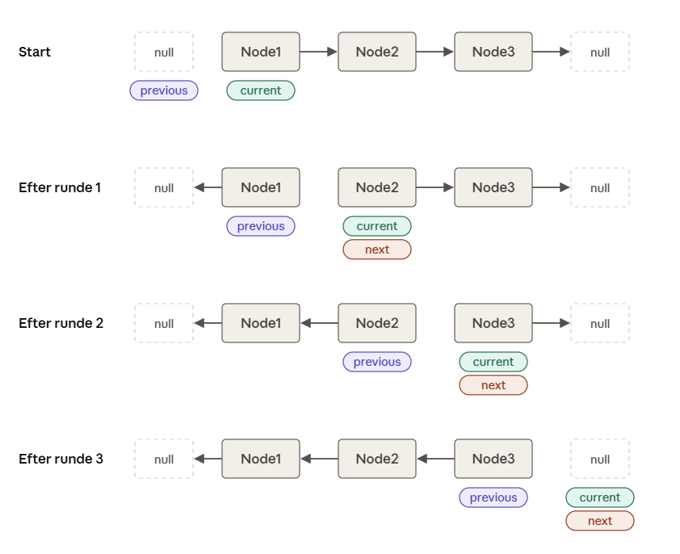

# Reversed linked list forklaret

En linked list består af noder, hvor hver node peger på den næste. 
Variablen `head` peger på den første node, og den sidste nodes `next` peger på `null`.

Vi bruger tre variabler til at holde styr på, hvor vi er:

- `previous`: den node, vi lige har været på. Den starter som `null`.
- `current`: den node, vi kigger på nu. Den starter som `head`.
- `next`: den node, vi skal kigge på bagefter.

Så gentager vi fire trin, så længe `current` ikke er `null`:

1. Sæt `next` til `current.next`. Det er den næste node, vi skal kigge på. `next` passer på resten af listen, 
mens vi "vender pilen" på den node, vi er i gang med.
2. Sæt `current.next` til `previous`. Vi "vender pilen". Det kan vi gøre, fordi `next` passer på resten af listen.
3. Sæt `previous` til `current`. Den node, vi står på, er om lidt den, vi lige har været på.
4. Sæt `current` til `next`. Vi rykker videre til næste node.

Når `current` er `null`, er vi forbi den sidste node. Så står `previous` på den node, der var den sidste, 
og som nu er det nye `head`. Derfor returnerer vi `previous`.



Invariant (det som er sandt før og efter hver iteration):

```text
previous står på starten* af den del af listen, der allerede er vendt.
current står på starten af den del, der endnu ikke er vendt.
```
\* med "starten" menes noden lige før `current`. Eftersom alt før `current` er vendt om, 
vil `previous` være starten på den omvendte liste og ikke slutningen. 